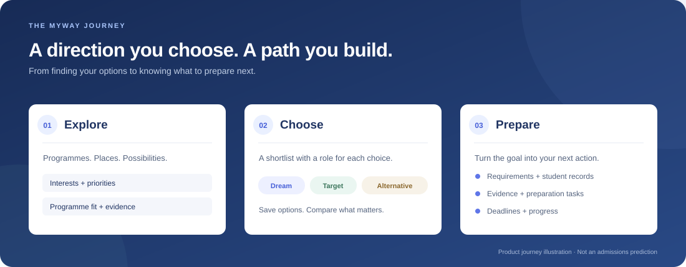
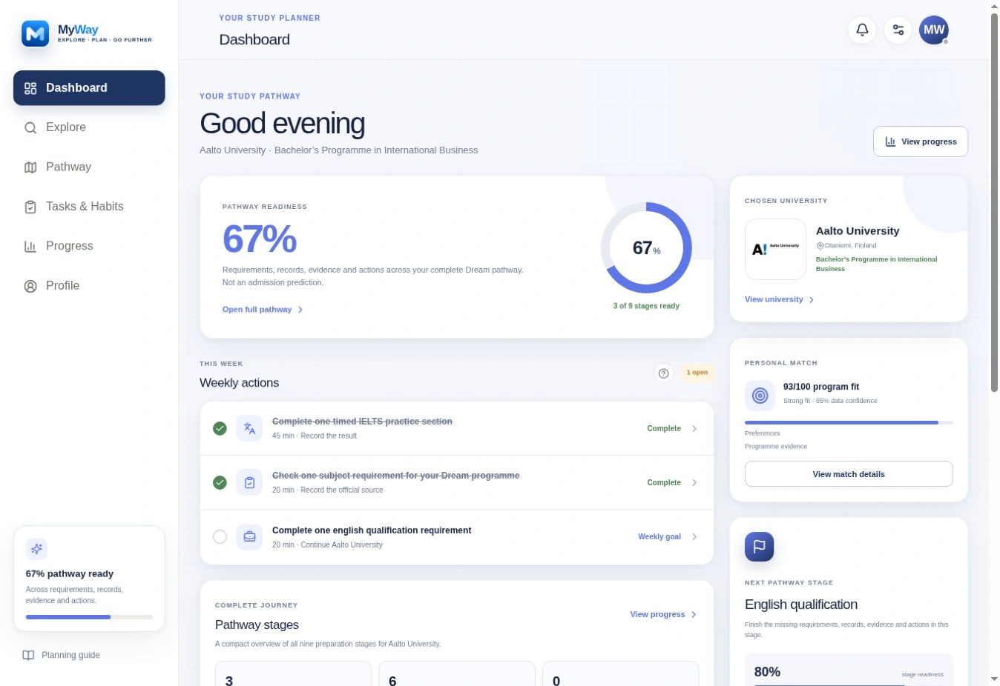
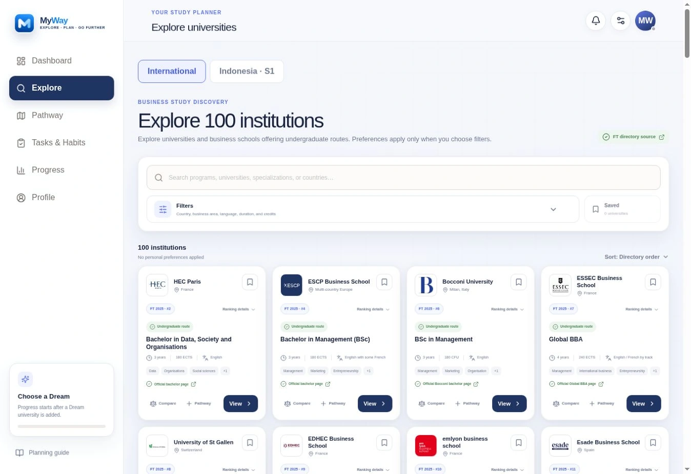
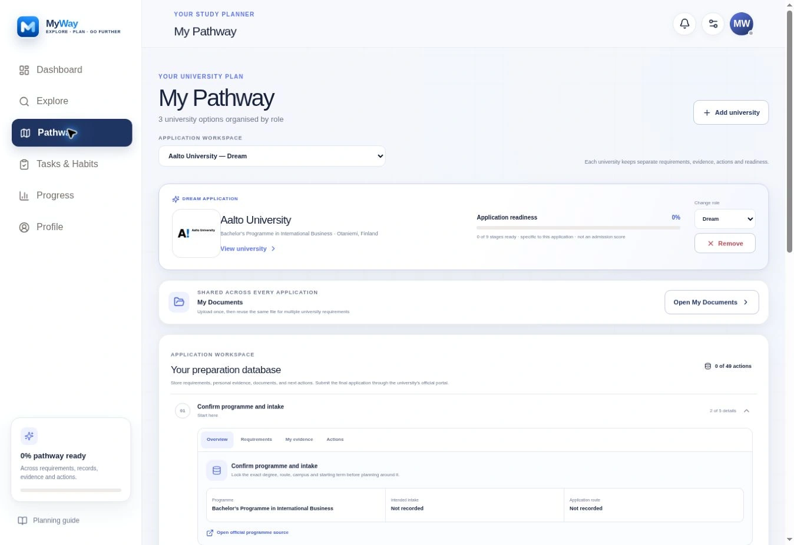

<div align="center">
  
  <h1>MyWay</h1>
  <p><strong>Explore. Plan. Go Further.</strong></p>
  <p>Discover your options. Build your university pathway. Keep moving toward your future.</p>
  <p><strong><a href="https://mywaypath.com">Explore MyWay →</a></strong> · <a href="#what-you-can-do">Discover the features</a> · <a href="#run-myway-locally">Run it locally</a> · <a href="docs/roadmap.md">See the roadmap</a></p>
  <p><a href="https://github.com/alifiandz/myway-showcase/actions/workflows/verify.yml"></a></p>
  <p>
    
    
    
    
    
  </p>
</div>

## A university shortlist is only the beginning.

**MyWay helps students move from “Where could I study?” to “What should I prepare next?”**

Explore universities in Indonesia and internationally, look closer at faculties and study programmes, and compare the options that matter to you. Organize your choices as **Dream, Target, or Alternative**, then bring requirements, dates, documents, and preparation work into a personal pathway.

Your dashboard connects the big goal with the next action. Tasks, habits, focus sessions, and progress views help turn research into preparation you can keep building.

<p align="center"></p>

## What you can do

| Your goal | How MyWay helps |
| --- | --- |
| Understand your university options | Indonesia and international discovery, search, filters, programme information, and links to source evidence. |
| Make a more informed shortlist | Save universities, compare choices, and organize Dream, Target, and Alternative pathways. |
| See why a programme may fit | Preference-based fit explanations make contributing factors and missing must-have evidence visible. |
| Know what to prepare | Pathway stages connect admission requirements, student records, supporting evidence, and next actions. |
| Keep important documents together | A document vault supports local file handling and configured account-based cloud storage and synchronization. |
| Turn preparation into consistent work | Tasks, habits, a month calendar, and focus-session tools support day-to-day preparation. |
| See what still needs attention | Readiness views, progress, and date-based planning reminders surface unfinished work. |
| Continue across devices | Account planning revision checks, conflict notices, and document-sync code support continuity when backend services are configured. |
| Keep the directory useful | Administrator tools support university and logo review, feedback, and authorized account/usage information. |

[Walk through the product →](docs/product-tour.md)

## A look inside MyWay

<p align="center"></p>

<table><tr><td width="50%"><br /><strong>Explore your options</strong></td><td width="50%"><br /><strong>Build your pathway</strong></td></tr></table>

<sub>Existing product screenshots captured with public catalogue and explicitly synthetic/example progress. No student account or private documents are shown. The captures predate the current transparent logo refresh; see the current mark above.</sub>

## The application source is here

This repository now includes the **full application source snapshot corresponding to Sites v182**, alongside the original public engineering examples. It includes pages, shared modules, styles, the landing experience, assets, Worker/API code, database migrations, and regression tests.

The earlier version of this repository contained only three extracted modules. Those examples are preserved under [`examples/engineering/`](examples/engineering/) so their original ten-test suite can still run independently.

This is a source release, not a copy of production data or a claim that every production integration has been independently verified. Live accounts, private documents, feedback records, university database rows, runtime secrets, and deployment credentials are not included.

## Built around clearer decisions

- **Readiness is preparation, not an admission prediction.** Progress describes completed preparation work.
- **Fit needs context.** Preference alignment should show its reasons and unverified must-haves.
- **Dates should be real.** Unknown or ambiguous dates should not become fabricated deadline reminders.
- **Changes should be intentional.** Planning revisions and conflict notices help avoid silently overwriting work.
- **Private files need account boundaries.** Local and cloud document implementations are included; their production authorization and recovery still need environment-specific validation.

MyWay does not submit university applications or guarantee admission. Confirm eligibility, fees, intakes, and deadlines with each university’s official sources.

## Run MyWay locally

Use **Node.js 22.13 or newer** and npm. Linux is the recommended environment for the retained Sites/Vinext scripts; macOS requires the dependencies’ native runtime support.

```sh
git clone https://github.com/alifiandz/myway-showcase.git
cd myway-showcase
npm ci
npm run dev
```

Open the local address printed by Vite. Local browsing can use the bundled catalogue and assets. Account, cloud-document, catalogue API, and administration features need your own configured services; missing configuration is not a working production backend.

See [local setup and configuration](docs/setup.md) before testing connected features.

### Check and build

```sh
npm run typecheck
npm test
npm run test:examples
```

`npm test` builds the Worker, validates the deployment artifact, and runs the full application regression suite. The build is generated in `dist/`. `npm run test:examples` runs the original ten synthetic-data examples without calling production services.

GitHub Actions runs these checks without deployment credentials. A green badge means the repository checks passed; it does not certify a live database or production security configuration.

## Where MyWay goes next

The roadmap strengthens the product that already exists:

1. **Better university evidence:** deeper programme coverage, clearer provenance, review status, and intake-specific verification.
2. **More useful pathways:** clearer next steps, requirements, preparation gaps, and explanations of fit and readiness.
3. **Stronger continuity:** better account/document recovery, conflict handling, and reliable cross-device workflows.
4. **Production confidence:** repeatable migration checks, account-boundary tests, accessibility, performance, and recovery rehearsals.

These are development priorities, not a dated release commitment or a claim that every improvement has shipped.

[Read the current status and development roadmap →](docs/roadmap.md)

## Under the hood

| Technology | Role |
| --- | --- |
| React + TypeScript | Product screens, typed logic, client state, and shared interactions. |
| Next.js conventions + Vinext/Vite | Application routing, development, and Worker builds. |
| Tailwind CSS + Lucide | Styling and interface icons. |
| Supabase | Account, catalogue, planning, and cloud-document integrations. |
| Cloudflare Workers + D1 + R2 | Worker/API runtime, feedback data, and supporting object storage. |
| IndexedDB + browser storage | Device-local documents, planning state, and continuity helpers. |
| Node test runner + runtime mocks | Regression tests for product logic, client boundaries, and Worker behavior. |
| GitHub Actions | Automated type checking, builds, and tests. |

```text
app/                    Application pages, admin tools, state and product logic
public/                 Transparent MyWay logo, landing page, images and logos
worker/                 Worker API routes and health checks
supabase/migrations/    Schema and policy migrations; no production database dump
db/, drizzle/           Supporting D1 schema and migrations
tests/                  Full application regression suite
examples/engineering/   Original three modules and ten independent tests
assets/                 README branding and journey illustration
docs/                   Setup, product guide, roadmap and source provenance
build/, scripts/        Build, validation and supporting tools
.github/workflows/      Automated verification; no automatic production release
```

## Development history

MyWay grew through **185 real source commits** before this public release. The original dates and development lineage are now preserved, rather than presenting the work as one upload.

[Explore the development timeline and restoration notes →](docs/development-history.md)

## Explore the build

- [Product guide](docs/product-tour.md)
- [Setup and configuration](docs/setup.md)
- [Current status and roadmap](docs/roadmap.md)
- [Publication scope and source provenance](docs/project-status.md)
- [Three earlier engineering decisions](docs/engineering.md)
- [The product’s build story](docs/build-story.md)

## Source and asset boundaries

The source snapshot is based on Sites v182 (`b1bca7d8185f6c531d2d3b3440e3d8b972669fdb`). The original website and private repository are unchanged. Production project identifiers and owner-specific administrator access values have been removed or made configurable in this public copy.

Institution names, facts, and third-party marks retain their respective rights. Source/attribution records shipped with the assets remain included; logos do not imply affiliation. No open-source license has been assigned to the application. Public visibility alone does not grant broad reuse rights.

---

**Your direction can change. Your preparation can keep moving.**

[Explore MyWay →](https://mywaypath.com)
